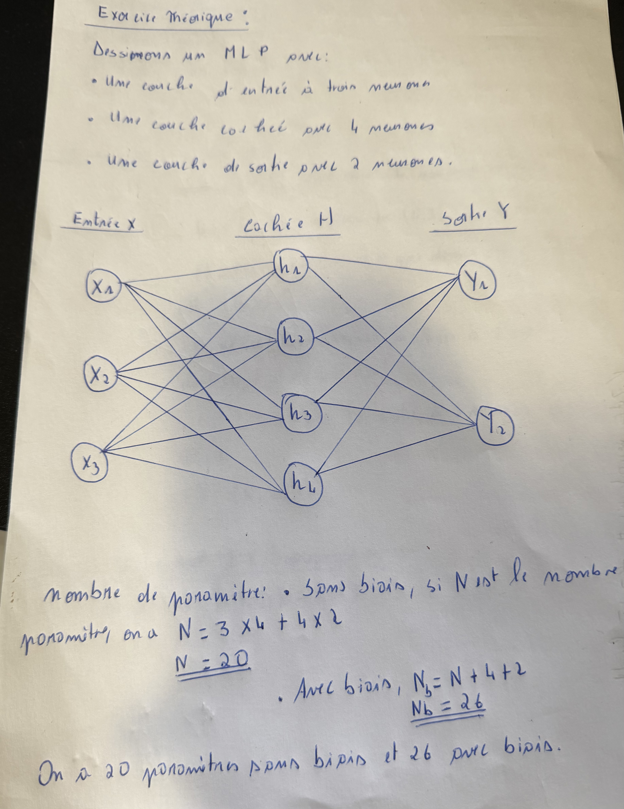
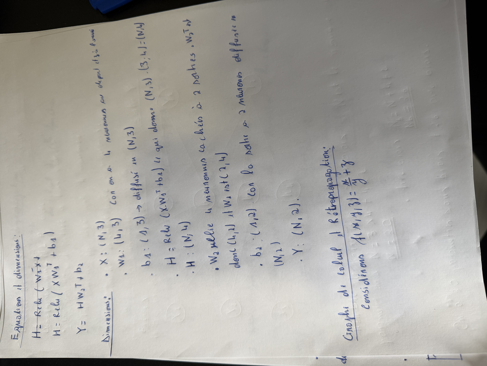
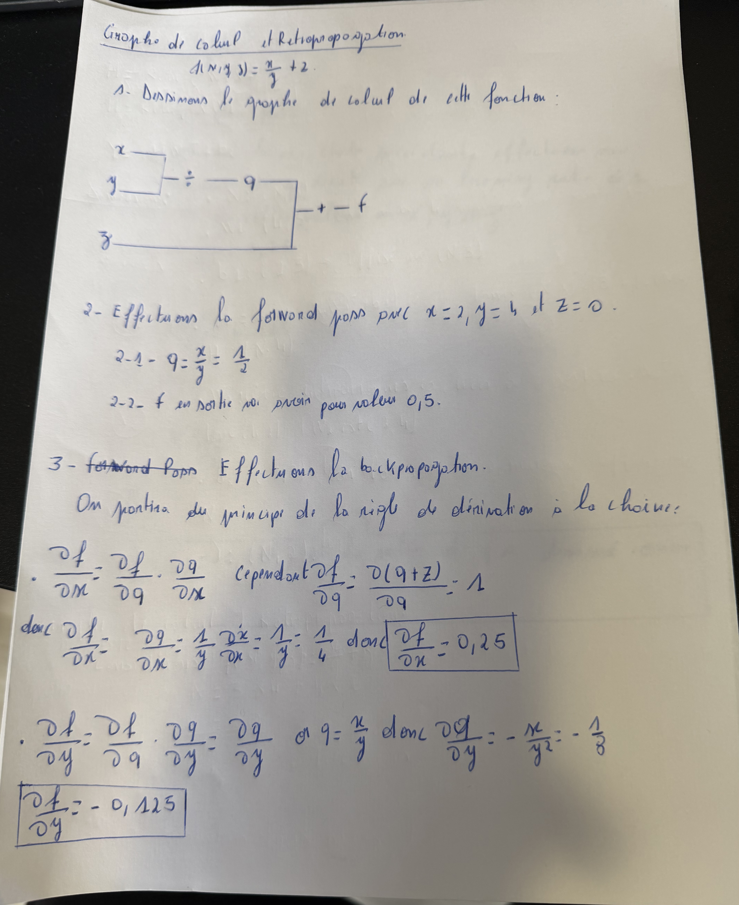

# TP1 — Premiers pas (CSC 8607 – Introduction au deep learning

---

## Exercice 1 — Utilisation de SLURM

### 1.a / 1.b — Connexion SSH et clé

Configuration `~/.ssh/config` avec deux hôtes : la passerelle `LAB_GATEWAY`
(`ssh2.imtbs-tsp.eu`) et le cluster `tsp-client`, joint via `ProxyJump`.
Clé utilisée : `ed25519`.

**Difficultés rencontrées et résolution :**
- **Accès non autorisé au cluster** (« not authorized to access the compute cluster ») :
  problème d'activation du compte, résolu après demande auprès du support (M. Jovart).
- **Empreinte d'hôte modifiée** (`REMOTE HOST IDENTIFICATION HAS CHANGED`) sur la passerelle
  et sur le cluster : suppression des anciennes empreintes avec `ssh-keygen -R <hôte>`,
  puis acceptation des nouvelles.
- **`Connection refused` sur la passerelle depuis le réseau de l'école** : depuis l'intérieur
  du réseau, connexion directe sans rebond (`ssh -J none tsp-client`) ; depuis l'extérieur,
  passage par la passerelle.
- **Timeout dans VS Code Remote-SSH** : délai de connexion augmenté
  (`remote.SSH.connectTimeout` = 60 s) pour laisser le temps au double saut SSH.

### 1.c — Premiers pas en mode interactif avec `srun`

Sur le nœud de connexion (`arcadia-slurm-controller`), `nvidia-smi` échoue
(« Command 'nvidia-smi' not found ») : ce nœud ne dispose pas de GPU.

**Remarque :** sur ce cluster, la commande du sujet est rejetée : Slurm exige de préciser
explicitement le compte (`--account`), la QOS (`--qos`) et un nom de job descriptif (`--job-name`).
Les valeurs disponibles s'obtiennent avec :

```bash
sacctmgr -n show assoc where user=$USER format=Account,QOS
```

Commande finalement utilisée :

```bash
srun --account=csc_8607 --qos=interactive --job-name=tp1-gpu-interactif --partition=gpu --gres=gpu:1 --time=01:00:00 --cpus-per-task=1 --mem=8G --pty bash
```

- Job alloué : `54507`
- Nœud de calcul : `starfighter-slurm-node-01-1`
- **Modèle exact du GPU alloué : NVIDIA L4** (23 034 MiB de mémoire, driver 595.84,
  version CUDA maximale supportée par le driver : 13.2)

### 1.d — Observer et arrêter ses jobs : `squeue`, `scancel`

Depuis un second terminal connecté au nœud de login, liste de mes jobs :

```bash
squeue -u $USER
```

```
JOBID PARTITION     NAME     USER ST  TIME  NODES NODELIST(REASON)
54507       gpu tp1-gpu- rzegangk  R  7:11      1 starfighter-slurm-node-01-1
```

Le job interactif a le JobID `54507` (état `R` = *Running*).

**Commande exacte utilisée pour annuler le job :**

```bash
scancel 54507
```

Effet observé dans le premier terminal : la session sur le nœud de calcul est interrompue
(`STEP 54507.0 ... CANCELLED ... DUE to SIGNAL Terminated`), et `squeue -u $USER`
n'affiche plus aucun job.

Les captures d'écran ci dessous le montre parfaitement : 


### 1.e — Soumettre un script non interactif avec `sbatch`

Script `hello.sh` (présent dans le dossier `TP1` du dépôt) :

```bash
#!/bin/bash
#SBATCH --account=csc_8607
#SBATCH --qos=normal
#SBATCH --partition=gpu
#SBATCH -t 01:00:00
#SBATCH --gres=gpu:1
#SBATCH --cpus-per-task=1
#SBATCH --mem=8G
#SBATCH -J hello-slurm
#SBATCH -o logs/%x-%j.out
#SBATCH -e logs/%x-%j.err

set -euo pipefail
mkdir -p logs

echo "Job $SLURM_JOB_ID on $SLURM_NODELIST"
nvidia-smi || echo "nvidia-smi indisponible"
echo "Bonjour depuis SLURM !"
```

Les options `--account` et `--qos` ont été ajoutées car elles sont exigées par ce cluster
(QOS `normal` pour un job batch).

**Remarque :** le dossier `logs/` doit exister *avant* la soumission. Slurm ouvre les fichiers
de sortie avant d'exécuter le script, donc le `mkdir -p logs` du script arrive trop tard
pour le premier lancement. Il a donc été créé au préalable avec `mkdir -p ~/TP1/logs`.

Soumission :

```bash
sbatch hello.sh
# Submitted batch job 54509
```

**Nom exact du fichier de log : `logs/hello-slurm-54509.out`**
(`%x` = nom du job `hello-slurm`, `%j` = JobID `54509`). Un fichier `logs/hello-slurm-54509.err`
est également créé ; il est vide, ce qui indique qu'aucune erreur n'a eu lieu.

Contenu du `.out` (extrait) :

```
Job 54509 on starfighter-slurm-node-01-1
...
|   0  NVIDIA L4                      Off |   00000000:06:10.0 Off |                    0 |
...
Bonjour depuis SLURM !
```

### 1.f — Analyser ses jobs : `sacct`

```bash
sacct -j 54509 --format=JobID,State,Elapsed,MaxRSS,ReqMem,ReqCPUS
```

```
JobID             State    Elapsed     MaxRSS     ReqMem  ReqCPUS
------------ ---------- ---------- ---------- ---------- --------
54509         COMPLETED   00:00:01                    8G        1
54509.batch   COMPLETED   00:00:01     17936K                   1
54509.extern  COMPLETED   00:00:02                              1
```

Le job est décomposé en étapes : `54509` (allocation globale), `54509.batch` (exécution
du script) et `54509.extern` (étape technique gérée par Slurm). MaxRSS est mesuré sur les étapes.

**Différence entre ReqMem et MaxRSS :**
- **ReqMem** est la quantité de mémoire **demandée** à Slurm lors de la soumission
  (`--mem=8G`). C'est une réservation : cette mémoire est bloquée pour le job pendant toute
  sa durée, que le job s'en serve ou non. Si le job la dépasse, Slurm peut le tuer.
- **MaxRSS** (*Maximum Resident Set Size*) est le **pic de mémoire RAM réellement utilisée**
  par le job pendant son exécution, mesuré par Slurm.

Ici, ReqMem = 8 Go alors que MaxRSS ≈ 17,5 Mo : le job a utilisé une infime partie de ce
qu'il avait réservé. Comparer ces deux valeurs permet d'ajuster `--mem` au plus juste pour les
prochains jobs, et de ne pas bloquer inutilement des ressources partagées.

### 1.h — Cheat-sheet (adaptée au cluster Albator)

| Usage | Commande |
|---|---|
| Lister mes jobs | `squeue -u $USER` |
| Annuler un job | `scancel JOBID` |
| Historique d'un job | `sacct -j JOBID --format=JobID,State,Elapsed,MaxRSS,ReqMem,ReqCPUS` |
| Compte et QOS disponibles | `sacctmgr -n show assoc where user=$USER format=Account,QOS` |
| Session GPU interactive | `srun --account=csc_8607 --qos=interactive --job-name=<nom> --partition=gpu --gres=gpu:1 --time=01:00:00 --cpus-per-task=1 --mem=8G --pty bash` |
| Job batch | `sbatch script.sh` (avec `--account=csc_8607` et `--qos=normal` dans les `#SBATCH`) |
| Diagnostics | `nvidia-smi`, `htop` |
| Transferts (depuis le Mac) | `scp`, `rsync -avhP` |

## Exercice 2 — Environnement virtuel Python

### 2.a / 2.b — Miniforge, Mamba et environnement `deeplearning`

Miniforge installé dans `~/miniforge3` (mamba 2.9.0), sur un nœud de calcul alloué via `srun`.
Création et activation de l'environnement :

```bash
mamba create -n deeplearning python=3.10
mamba activate deeplearning
```

**Commande de vérification de la version de Python et du binaire utilisé :**

```bash
python --version
which python
```

Résultat :

```
Python 3.10.22
/mnt/hdd/homes/rzegangketcha/miniforge3/envs/deeplearning/bin/python
```

Le binaire utilisé est bien celui de l'environnement `deeplearning`, et non le Python du système.

### 2.c — Installation de PyTorch (GPU) et TensorBoard

La commande du sujet (`mamba install pytorch torchvision torchaudio pytorch-cuda=12.1 -c pytorch -c nvidia`)
a installé un build **CPU uniquement** de PyTorch (`torch.version.cuda` renvoyait `None`) :
Miniforge donne la priorité au canal conda-forge, où mamba a sélectionné un build CPU.

Correction : réinstallation en forçant un build CUDA depuis conda-forge :

```bash
mamba remove pytorch torchvision torchaudio pytorch-cuda
mamba install -c conda-forge "pytorch=*=*cuda*" torchvision torchaudio
mamba install tensorboard -c conda-forge
```

Vérification :

```bash
python -c "import torch; print(torch.__version__, torch.version.cuda, torch.cuda.is_available())"
# 2.13.0 13.0 True
```

PyTorch 2.13.0 compilé avec CUDA 13.0, compatible avec le driver du nœud (CUDA ≤ 13.2) ;
TensorBoard 2.20.0.

### 2.d — Vérification de l'installation PyTorch + CUDA

Script `check_gpu.py` (présent dans le dossier `TP1` du dépôt) :

```python
import torch

print("PyTorch version:", torch.__version__)
gpu_available = torch.cuda.is_available()
print("CUDA available:", gpu_available)
if gpu_available:
    print("Device count:", torch.cuda.device_count())
    print("Device 0 name:", torch.cuda.get_device_name(0))
else:
    print("Attention, aucun GPU détecté !")
```

Exécution sur un nœud de calcul (`python check_gpu.py`) :

```
PyTorch version: 2.13.0
CUDA available: True
Device count: 1
Device 0 name: NVIDIA L4
```

**Raisons possibles si `CUDA available` renvoyait `False`** (liste non exhaustive) :
1. **Le script s'exécute sur une machine sans GPU accessible** : par exemple sur le nœud de
   login, ou dans une allocation Slurm sans `--gres=gpu:1`. PyTorch ne voit alors aucun GPU.
2. **La version de PyTorch installée est un build CPU uniquement** (`torch.version.cuda` vaut
   `None`). C'est ce qui s'est produit lors de la première installation (voir 2.c).

Parmi les autres causes possibles, on peut citer un driver NVIDIA trop ancien pour la version de
CUDA avec laquelle PyTorch a été compilé.

### 2.e — Rendre l'environnement reproductible

```bash
mamba env export --from-history -n deeplearning > environment.yml
```

L'option `--from-history` n'exporte que les paquets demandés explicitement (et non toutes les
dépendances avec leurs builds exacts), ce qui rend le fichier lisible et portable.
La ligne `prefix:` (chemin absolu propre à ma machine) a été supprimée pour la même raison.

Contenu de `environment.yml` (versionné dans le dossier `TP1`) :

```yaml
name: deeplearning
channels:
  - conda-forge
dependencies:
  - pip
  - python=3.10
  - pytorch[build="*cuda*"]
  - tensorboard
  - torchaudio
  - torchvision
```

La contrainte `pytorch[build="*cuda*"]` garantit qu'une recréation de l'environnement
(`mamba env create -f environment.yml`) installera un build GPU de PyTorch, et non un build CPU.

### 2.f — Version de TensorBoard (bonus)

**Commande :**

```bash
tensorboard --version
```

Résultat : **`2.20.0`**

Deux messages non bloquants s'affichent avant la version : un avertissement de dépréciation
de `pkg_resources` (module de `setuptools` utilisé par TensorBoard) et l'indication que
TensorFlow n'est pas installé. TensorBoard fonctionne en mode « réduit » sans TensorFlow,
ce qui suffit pour visualiser les logs écrits par PyTorch (`torch.utils.tensorboard.SummaryWriter`).


## Exercice 3 — Exercices théoriques (Papier & Markdown) 






### 3.e — Questions de réflexion

**Pourquoi utilise-t-on la règle de la chaîne pour calculer les gradients dans les réseaux de neurones profonds ?**

Un réseau profond est une composition de nombreuses fonctions simples (couches linéaires, activations, loss),
et la règle de la chaîne permet d'obtenir le gradient de la loss par rapport à chaque paramètre en multipliant
des gradients locaux, faciles à calculer nœud par nœud. En remontant le graphe de la sortie vers l'entrée
(rétropropagation), les gradients intermédiaires sont calculés une seule fois puis réutilisés, ce qui rend le
calcul efficace même avec des millions de paramètres.

**Quelles sont les principales raisons d'utiliser des mini-batchs plutôt que d'optimiser sur un seul exemple à la fois ou sur l'ensemble total des données ?**

Un seul exemple donne un gradient très bruité et exploite mal le parallélisme du GPU, tandis que l'ensemble
complet des données ne tient généralement pas en mémoire et ne permet qu'une mise à jour des poids par
passage sur les données. Le mini-batch est un compromis : il fournit une estimation du gradient suffisamment
stable, tient en mémoire GPU, tire parti du calcul parallèle et permet des mises à jour fréquentes des poids.
Le léger bruit qu'il conserve peut en outre aider l'optimisation à ne pas rester bloquée dans un mauvais minimum.

### 3.f — Association couche de sortie / fonction de perte

| Tâche                  | Fonction finale (Sortie) | Fonction de perte (Loss)          |
|------------------------|--------------------------|-----------------------------------|
| Classification binaire | 1. Sigmoïde              | A. Binary Cross-Entropy (BCE)     |
| Classification multi   | 2. Softmax               | B. Cross-Entropy (catégorielle)   |
| Régression pure        | 3. Identité (aucune)     | C. MSE (Mean Squared Error)       |

- La **sigmoïde** ramène la sortie dans ]0, 1[, interprétable comme la probabilité de la classe positive.
- Le **softmax** transforme le vecteur de scores en une distribution de probabilités sur les classes (somme = 1).
- En régression, la sortie n'est pas contrainte, d'où l'identité et une loss de distance (MSE).

