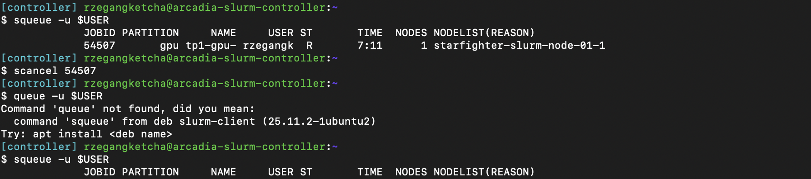
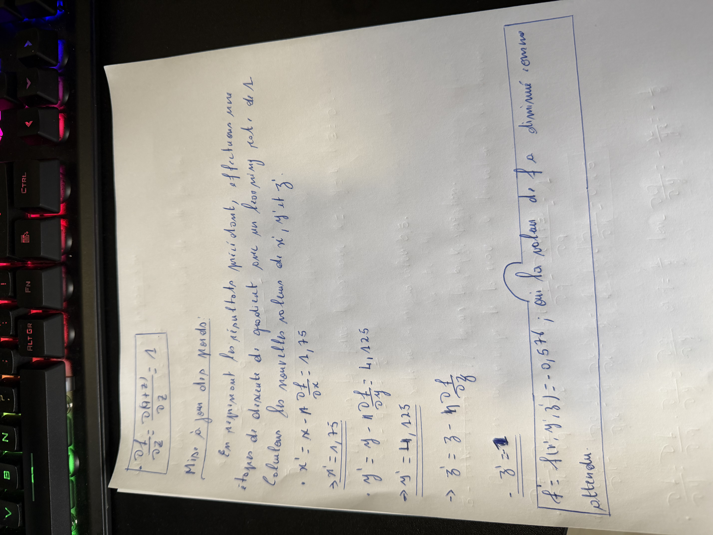
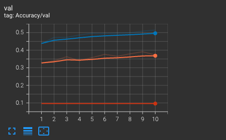
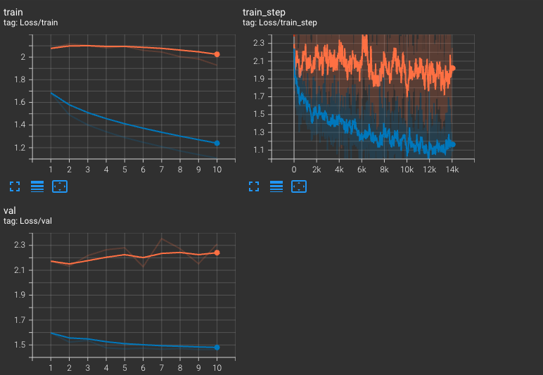

# TP1 — Premiers pas (CSC 8607 – Introduction au deep learning

---

## Exercice 1 — Utilisation de SLURM

### 1.a / 1.b — Connexion SSH et clé

Configuration `~/.ssh/config` avec deux hôtes : la passerelle `LAB_GATEWAY`
(`ssh2.imtbs-tsp.eu`) et le cluster `tsp-client`, joint via `ProxyJump`.
Clé utilisée : `ed25519`.

**Difficultés rencontrées et résolution :**
- **Accès non autorisé au cluster** (« not authorized to access the compute cluster ») :
  problème d'activation du compte, résolu après demande auprès du support (M. Jovart).
- **Empreinte d'hôte modifiée** (`REMOTE HOST IDENTIFICATION HAS CHANGED`) sur la passerelle
  et sur le cluster : suppression des anciennes empreintes avec `ssh-keygen -R <hôte>`,
  puis acceptation des nouvelles.
- **`Connection refused` sur la passerelle depuis le réseau de l'école** : depuis l'intérieur
  du réseau, connexion directe sans rebond (`ssh -J none tsp-client`) ; depuis l'extérieur,
  passage par la passerelle.
- **Timeout dans VS Code Remote-SSH** : délai de connexion augmenté
  (`remote.SSH.connectTimeout` = 60 s) pour laisser le temps au double saut SSH.

### 1.c — Premiers pas en mode interactif avec `srun`

Sur le nœud de connexion (`arcadia-slurm-controller`), `nvidia-smi` échoue
(« Command 'nvidia-smi' not found ») : ce nœud ne dispose pas de GPU.

**Remarque :** sur ce cluster, la commande du sujet est rejetée : Slurm exige de préciser
explicitement le compte (`--account`), la QOS (`--qos`) et un nom de job descriptif (`--job-name`).
Les valeurs disponibles s'obtiennent avec :

```bash
sacctmgr -n show assoc where user=$USER format=Account,QOS
```

Commande finalement utilisée :

```bash
srun --account=csc_8607 --qos=interactive --job-name=tp1-gpu-interactif --partition=gpu --gres=gpu:1 --time=01:00:00 --cpus-per-task=1 --mem=8G --pty bash
```

- Job alloué : `54507`
- Nœud de calcul : `starfighter-slurm-node-01-1`
- **Modèle exact du GPU alloué : NVIDIA L4** (23 034 MiB de mémoire, driver 595.84,
  version CUDA maximale supportée par le driver : 13.2)

### 1.d — Observer et arrêter ses jobs : `squeue`, `scancel`

Depuis un second terminal connecté au nœud de login, liste de mes jobs :

```bash
squeue -u $USER
```

```
JOBID PARTITION     NAME     USER ST  TIME  NODES NODELIST(REASON)
54507       gpu tp1-gpu- rzegangk  R  7:11      1 starfighter-slurm-node-01-1
```

Le job interactif a le JobID `54507` (état `R` = *Running*).

**Commande exacte utilisée pour annuler le job :**

```bash
scancel 54507
```

Effet observé dans le premier terminal : la session sur le nœud de calcul est interrompue
(`STEP 54507.0 ... CANCELLED ... DUE to SIGNAL Terminated`), et `squeue -u $USER`
n'affiche plus aucun job.

Les captures d'écran ci dessous le montre parfaitement : 



### 1.e — Soumettre un script non interactif avec `sbatch`

Script `hello.sh` (présent dans le dossier `TP1` du dépôt) :

```bash
#!/bin/bash
#SBATCH --account=csc_8607
#SBATCH --qos=normal
#SBATCH --partition=gpu
#SBATCH -t 01:00:00
#SBATCH --gres=gpu:1
#SBATCH --cpus-per-task=1
#SBATCH --mem=8G
#SBATCH -J hello-slurm
#SBATCH -o logs/%x-%j.out
#SBATCH -e logs/%x-%j.err

set -euo pipefail
mkdir -p logs

echo "Job $SLURM_JOB_ID on $SLURM_NODELIST"
nvidia-smi || echo "nvidia-smi indisponible"
echo "Bonjour depuis SLURM !"
```

Les options `--account` et `--qos` ont été ajoutées car elles sont exigées par ce cluster
(QOS `normal` pour un job batch).

**Remarque :** le dossier `logs/` doit exister *avant* la soumission. Slurm ouvre les fichiers
de sortie avant d'exécuter le script, donc le `mkdir -p logs` du script arrive trop tard
pour le premier lancement. Il a donc été créé au préalable avec `mkdir -p ~/TP1/logs`.

Soumission :

```bash
sbatch hello.sh
# Submitted batch job 54509
```

**Nom exact du fichier de log : `logs/hello-slurm-54509.out`**
(`%x` = nom du job `hello-slurm`, `%j` = JobID `54509`). Un fichier `logs/hello-slurm-54509.err`
est également créé ; il est vide, ce qui indique qu'aucune erreur n'a eu lieu.

Contenu du `.out` (extrait) :

```
Job 54509 on starfighter-slurm-node-01-1
...
|   0  NVIDIA L4                      Off |   00000000:06:10.0 Off |                    0 |
...
Bonjour depuis SLURM !
```

### 1.f — Analyser ses jobs : `sacct`

```bash
sacct -j 54509 --format=JobID,State,Elapsed,MaxRSS,ReqMem,ReqCPUS
```

```
JobID             State    Elapsed     MaxRSS     ReqMem  ReqCPUS
------------ ---------- ---------- ---------- ---------- --------
54509         COMPLETED   00:00:01                    8G        1
54509.batch   COMPLETED   00:00:01     17936K                   1
54509.extern  COMPLETED   00:00:02                              1
```

Le job est décomposé en étapes : `54509` (allocation globale), `54509.batch` (exécution
du script) et `54509.extern` (étape technique gérée par Slurm). MaxRSS est mesuré sur les étapes.

**Différence entre ReqMem et MaxRSS :**
- **ReqMem** est la quantité de mémoire **demandée** à Slurm lors de la soumission
  (`--mem=8G`). C'est une réservation : cette mémoire est bloquée pour le job pendant toute
  sa durée, que le job s'en serve ou non. Si le job la dépasse, Slurm peut le tuer.
- **MaxRSS** (*Maximum Resident Set Size*) est le **pic de mémoire RAM réellement utilisée**
  par le job pendant son exécution, mesuré par Slurm.

Ici, ReqMem = 8 Go alors que MaxRSS ≈ 17,5 Mo : le job a utilisé une infime partie de ce
qu'il avait réservé. Comparer ces deux valeurs permet d'ajuster `--mem` au plus juste pour les
prochains jobs, et de ne pas bloquer inutilement des ressources partagées.

### 1.h — Cheat-sheet (adaptée au cluster Albator)

| Usage | Commande |
|---|---|
| Lister mes jobs | `squeue -u $USER` |
| Annuler un job | `scancel JOBID` |
| Historique d'un job | `sacct -j JOBID --format=JobID,State,Elapsed,MaxRSS,ReqMem,ReqCPUS` |
| Compte et QOS disponibles | `sacctmgr -n show assoc where user=$USER format=Account,QOS` |
| Session GPU interactive | `srun --account=csc_8607 --qos=interactive --job-name=<nom> --partition=gpu --gres=gpu:1 --time=01:00:00 --cpus-per-task=1 --mem=8G --pty bash` |
| Job batch | `sbatch script.sh` (avec `--account=csc_8607` et `--qos=normal` dans les `#SBATCH`) |
| Diagnostics | `nvidia-smi`, `htop` |
| Transferts (depuis le Mac) | `scp`, `rsync -avhP` |

## Exercice 2 — Environnement virtuel Python

### 2.a / 2.b — Miniforge, Mamba et environnement `deeplearning`

Miniforge installé dans `~/miniforge3` (mamba 2.9.0), sur un nœud de calcul alloué via `srun`.
Création et activation de l'environnement :

```bash
mamba create -n deeplearning python=3.10
mamba activate deeplearning
```

**Commande de vérification de la version de Python et du binaire utilisé :**

```bash
python --version
which python
```

Résultat :

```
Python 3.10.22
/mnt/hdd/homes/rzegangketcha/miniforge3/envs/deeplearning/bin/python
```

Le binaire utilisé est bien celui de l'environnement `deeplearning`, et non le Python du système.

### 2.c — Installation de PyTorch (GPU) et TensorBoard

La commande du sujet (`mamba install pytorch torchvision torchaudio pytorch-cuda=12.1 -c pytorch -c nvidia`)
a installé un build **CPU uniquement** de PyTorch (`torch.version.cuda` renvoyait `None`) :
Miniforge donne la priorité au canal conda-forge, où mamba a sélectionné un build CPU.

Correction : réinstallation en forçant un build CUDA depuis conda-forge :

```bash
mamba remove pytorch torchvision torchaudio pytorch-cuda
mamba install -c conda-forge "pytorch=*=*cuda*" torchvision torchaudio
mamba install tensorboard -c conda-forge
```

Vérification :

```bash
python -c "import torch; print(torch.__version__, torch.version.cuda, torch.cuda.is_available())"
# 2.13.0 13.0 True
```

PyTorch 2.13.0 compilé avec CUDA 13.0, compatible avec le driver du nœud (CUDA ≤ 13.2) ;
TensorBoard 2.20.0.

### 2.d — Vérification de l'installation PyTorch + CUDA

Script `check_gpu.py` (présent dans le dossier `TP1` du dépôt) :

```python
import torch

print("PyTorch version:", torch.__version__)
gpu_available = torch.cuda.is_available()
print("CUDA available:", gpu_available)
if gpu_available:
    print("Device count:", torch.cuda.device_count())
    print("Device 0 name:", torch.cuda.get_device_name(0))
else:
    print("Attention, aucun GPU détecté !")
```

Exécution sur un nœud de calcul (`python check_gpu.py`) :

```
PyTorch version: 2.13.0
CUDA available: True
Device count: 1
Device 0 name: NVIDIA L4
```

**Raisons possibles si `CUDA available` renvoyait `False`** (liste non exhaustive) :
1. **Le script s'exécute sur une machine sans GPU accessible** : par exemple sur le nœud de
   login, ou dans une allocation Slurm sans `--gres=gpu:1`. PyTorch ne voit alors aucun GPU.
2. **La version de PyTorch installée est un build CPU uniquement** (`torch.version.cuda` vaut
   `None`). C'est ce qui s'est produit lors de la première installation (voir 2.c).

Parmi les autres causes possibles, on peut citer un driver NVIDIA trop ancien pour la version de
CUDA avec laquelle PyTorch a été compilé.

### 2.e — Rendre l'environnement reproductible

```bash
mamba env export --from-history -n deeplearning > environment.yml
```

L'option `--from-history` n'exporte que les paquets demandés explicitement (et non toutes les
dépendances avec leurs builds exacts), ce qui rend le fichier lisible et portable.
La ligne `prefix:` (chemin absolu propre à ma machine) a été supprimée pour la même raison.

Contenu de `environment.yml` (versionné dans le dossier `TP1`) :

```yaml
name: deeplearning
channels:
  - conda-forge
dependencies:
  - pip
  - python=3.10
  - pytorch[build="*cuda*"]
  - tensorboard
  - torchaudio
  - torchvision
```

La contrainte `pytorch[build="*cuda*"]` garantit qu'une recréation de l'environnement
(`mamba env create -f environment.yml`) installera un build GPU de PyTorch, et non un build CPU.

### 2.f — Version de TensorBoard (bonus)

**Commande :**

```bash
tensorboard --version
```

Résultat : **`2.20.0`**

Deux messages non bloquants s'affichent avant la version : un avertissement de dépréciation
de `pkg_resources` (module de `setuptools` utilisé par TensorBoard) et l'indication que
TensorFlow n'est pas installé. TensorBoard fonctionne en mode « réduit » sans TensorFlow,
ce qui suffit pour visualiser les logs écrits par PyTorch (`torch.utils.tensorboard.SummaryWriter`).


## Exercice 3 — Exercices théoriques (Papier & Markdown) 




### 3.e — Questions de réflexion

**Pourquoi utilise-t-on la règle de la chaîne pour calculer les gradients dans les réseaux de neurones profonds ?**

Un réseau profond est une composition de nombreuses fonctions simples (couches linéaires, activations, loss),
et la règle de la chaîne permet d'obtenir le gradient de la loss par rapport à chaque paramètre en multipliant
des gradients locaux, faciles à calculer nœud par nœud. En remontant le graphe de la sortie vers l'entrée
(rétropropagation), les gradients intermédiaires sont calculés une seule fois puis réutilisés, ce qui rend le
calcul efficace même avec des millions de paramètres.

**Quelles sont les principales raisons d'utiliser des mini-batchs plutôt que d'optimiser sur un seul exemple à la fois ou sur l'ensemble total des données ?**

Un seul exemple donne un gradient très bruité et exploite mal le parallélisme du GPU, tandis que l'ensemble
complet des données ne tient généralement pas en mémoire et ne permet qu'une mise à jour des poids par
passage sur les données. Le mini-batch est un compromis : il fournit une estimation du gradient suffisamment
stable, tient en mémoire GPU, tire parti du calcul parallèle et permet des mises à jour fréquentes des poids.
Le léger bruit qu'il conserve peut en outre aider l'optimisation à ne pas rester bloquée dans un mauvais minimum.

### 3.f — Association couche de sortie / fonction de perte

| Tâche                  | Fonction finale (Sortie) | Fonction de perte (Loss)          |
|------------------------|--------------------------|-----------------------------------|
| Classification binaire | 1. Sigmoïde              | A. Binary Cross-Entropy (BCE)     |
| Classification multi   | 2. Softmax               | B. Cross-Entropy (catégorielle)   |
| Régression pure        | 3. Identité (aucune)     | C. MSE (Mean Squared Error)       |

- La **sigmoïde** ramène la sortie dans ]0, 1[, interprétable comme la probabilité de la classe positive.
- Le **softmax** transforme le vecteur de scores en une distribution de probabilités sur les classes (somme = 1).
- En régression, la sortie n'est pas contrainte, d'où l'identité et une loss de distance (MSE).

## Exercice 4 — Premier réseau de neurones (CIFAR-10)

### 4.a — Préparation des données

Chargement de CIFAR-10 avec `train=True` (50 000 images d'entraînement) et `train=False`
(10 000 images de test), normalisées canal par canal avec la moyenne et l'écart-type du dataset.
DataLoaders : `shuffle=True` pour l'entraînement, `shuffle=False` pour le test.

**Rôle de `batch_size` :** il fixe le nombre d'exemples traités ensemble à chaque itération (ici 32).
Le modèle calcule la loss moyenne et les gradients sur ce mini-batch, puis met à jour ses poids une fois
par batch. C'est le compromis entre stabilité du gradient, mémoire GPU et nombre de mises à jour (cf. 3.e).

**Rôle de `shuffle` :** il mélange l'ordre des exemples à chaque époque.

**Pourquoi des valeurs différentes pour l'entraînement et le test ?**
- **Entraînement (`shuffle=True`)** : mélanger évite que le modèle voie les exemples toujours dans le
  même ordre (par exemple regroupés par classe), ce qui biaiserait les mises à jour successives.
  Les mini-batchs sont ainsi plus représentatifs, ce qui améliore la convergence et la généralisation.
- **Test (`shuffle=False`)** : l'évaluation ne met pas à jour les poids, donc l'ordre n'a aucun effet sur
  la précision calculée. Un ordre fixe rend l'évaluation déterministe et reproductible, et permet de
  relier facilement chaque prédiction à son exemple.

  ### 4.b — Implémentation du réseau (MLP)

```python
class MLP(nn.Module):
    def __init__(self):
        super().__init__()
        self.fc1 = nn.Linear(32 * 32 * 3, 128)  # 3072 entrées -> 128 neurones cachés
        self.fc2 = nn.Linear(128, 10)           # 128 -> 10 logits (une par classe)

    def forward(self, x):
        x = torch.flatten(x, 1)
        x = F.relu(self.fc1(x))
        x = self.fc2(x)  # pas de Softmax
        return x
```

**1. Pourquoi `torch.flatten(x, 1)` avant la couche linéaire ?**

Le DataLoader fournit des images sous forme de tenseur de dimensions `(N, 3, 32, 32)` (batch, canaux,
hauteur, largeur), alors qu'une couche `nn.Linear` attend des vecteurs, c'est-à-dire un tenseur de
dimensions `(N, nombre_de_features)`. `torch.flatten(x, 1)` aplatit toutes les dimensions **à partir de
la dimension 1**, ce qui donne `(N, 3072)` : chaque image devient un vecteur de 3 × 32 × 32 = 3072 valeurs,
tandis que la dimension 0 (le batch) est **préservée**. Un `torch.flatten(x)` sans argument fusionnerait
aussi la dimension du batch et produirait un unique vecteur de taille N × 3072, ce qui serait incorrect.

**2. Pourquoi ne pas ajouter de Softmax à la fin quand on utilise `nn.CrossEntropyLoss` ?**

`nn.CrossEntropyLoss` attend des **logits bruts** : elle applique elle-même un log-softmax en interne,
suivi de la negative log-likelihood. Ajouter un Softmax dans le modèle reviendrait à l'appliquer deux fois :
les probabilités seraient écrasées vers des valeurs proches les unes des autres, les gradients
s'affaibliraient et l'apprentissage serait ralenti. De plus, le calcul combiné log-softmax de PyTorch est
numériquement plus stable qu'un Softmax suivi d'un logarithme séparé. Pour obtenir la classe prédite,
un `argmax` sur les logits suffit, puisque le Softmax ne change pas l'ordre des scores.

### 4.c — Entraînement du modèle

Boucle d'entraînement (extrait) :

```python
optimizer.zero_grad(set_to_none=True)   # 1. réinitialiser les gradients
outputs = model(inputs)                 # 2. forward
loss = criterion(outputs, labels)       # 3. calcul de la perte
loss.backward()                         # 4. rétropropagation
optimizer.step()                        # 5. mise à jour des poids
```

Exécution via Slurm avec le script `train.sh` (`sbatch train.sh`, job `55891`), qui active l'environnement
`deeplearning` puis lance `python -u train.py` sur un nœud GPU (`starfighter-slurm-node-03-1`).

Résultats d'entraînement (10 époques, SGD lr=0.01, momentum=0.9, batch 32) :

```
Epoch 01 | loss=2.0883 | acc=0.3304
Epoch 02 | loss=2.1281 | acc=0.3560
Epoch 03 | loss=2.1288 | acc=0.3650
Epoch 04 | loss=2.0725 | acc=0.3836
Epoch 05 | loss=2.0766 | acc=0.3862
Epoch 06 | loss=2.0587 | acc=0.3939
Epoch 07 | loss=2.0087 | acc=0.4081
Epoch 08 | loss=2.0123 | acc=0.4098
Epoch 09 | loss=1.9616 | acc=0.4203
Epoch 10 | loss=1.9358 | acc=0.4262
```

L'accuracy d'entraînement progresse de 33 % à 42,6 %, nettement au-dessus du hasard (10 %).
La loss diminue globalement mais de façon irrégulière (remontées aux époques 2-3, 5 et 8), ce qui
suggère que la combinaison lr = 0,01 / momentum = 0,9 rend l'optimisation quelque peu instable pour ce MLP.

**Différence fondamentale entre `optimizer.zero_grad()` et `loss.backward()` :**

- `loss.backward()` **calcule** les gradients de la loss par rapport à tous les paramètres du modèle, par
  rétropropagation dans le graphe de calcul, et les **ajoute** dans l'attribut `.grad` de chaque paramètre.
- `optimizer.zero_grad()` **remet à zéro** (ou à `None` avec `set_to_none=True`) ces attributs `.grad`.

Par défaut, PyTorch **accumule** les gradients à chaque appel de `backward()`. Sans `zero_grad()`
au début de chaque itération, les gradients du batch courant s'additionneraient à ceux des batchs
précédents, et les mises à jour seraient fausses. Aucune des deux fonctions ne modifie les poids :
c'est `optimizer.step()` qui applique la mise à jour à partir des gradients calculés.

### 4.d — Évaluation sur l'ensemble de test

Code d'évaluation ajouté à la fin de `train.py` (`model.eval()`, boucle sur `testloader` dans un bloc
`with torch.no_grad():`, prédiction par `torch.max` sur les logits), puis nouveau lancement (job `55912`) :

```
Epoch 10 | loss=1.9358 | acc=0.4262
Test accuracy: 0.389
```

**Test accuracy obtenue : 0,389 (38,9 %).**

Les 10 époques sont identiques à celles du run précédent (job `55891`) grâce aux graines aléatoires fixées :
l'expérience est reproductible. La test accuracy (38,9 %) est près de 4 fois supérieure au hasard (10 %),
et légèrement inférieure à l'accuracy d'entraînement (42,6 %) : le modèle généralise raisonnablement,
avec un écart train/test modéré.

**1. Pourquoi utilise-t-on `with torch.no_grad():` lors de l'évaluation ? Quel avantage en ressources ?**

Pendant l'évaluation, on ne met pas à jour les poids : on n'appelle jamais `backward()`, les gradients
sont donc inutiles. Le bloc `torch.no_grad()` désactive le suivi des opérations par l'autograd :
PyTorch ne construit pas le graphe de calcul et ne conserve pas les activations intermédiaires
nécessaires à la rétropropagation.
L'avantage matériel est double : **moins de mémoire** consommée (en particulier la mémoire GPU, ce qui
permet par exemple des batchs d'évaluation plus grands) et des **calculs plus rapides**, puisque
l'enregistrement du graphe est supprimé.

**2. Accuracy attendue pour un classificateur purement aléatoire sur CIFAR-10 ?**

CIFAR-10 comporte **10 classes**, et son jeu de test est équilibré (1 000 images par classe).
Un classificateur qui choisit une classe au hasard a donc une probabilité de 1/10 d'avoir raison
pour chaque image : on s'attend à une accuracy d'environ **10 %**. C'est la référence minimale à
dépasser pour que le modèle ait appris quelque chose d'utile.

### 4.e — Sauvegarde et chargement du modèle

Les poids du modèle sont sauvegardés à la fin de `train.py` :

```python
torch.save(model.state_dict(), "mlp_model.pth")
```

On sauvegarde le `state_dict` (dictionnaire des tenseurs de poids et de biais) plutôt que l'objet
modèle complet : c'est plus léger et plus robuste. Pour recharger le modèle, il suffit de recréer
l'architecture `MLP()` puis d'appeler `load_state_dict(...)`, par exemple sur CPU avec
`torch.load("mlp_model.pth", map_location="cpu", weights_only=True)`.

## Exercice 5 — Utilisation de TensorBoard

### 5.a — Préparation : split train/validation et hyperparamètres

Le jeu d'entraînement CIFAR-10 (50 000 images) est découpé avec `random_split` en **45 000 images
d'entraînement** et **5 000 images de validation** (10 %), avec une graine fixe pour que le découpage
soit reproductible. Le jeu de test n'est pas utilisé pendant le développement : il est réservé à la
mesure finale.

Chaque run écrit ses logs dans un dossier unique, construit à partir des hyperparamètres et d'un
horodatage, par exemple .

**Pourquoi inclure la date, l'heure et les hyperparamètres dans le nom du dossier de logs ?**

- **Unicité** : l'horodatage garantit que chaque run a son propre dossier. Relancer une expérience
  n'écrase pas et ne mélange pas les logs d'un run précédent : TensorBoard afficherait sinon
  plusieurs courbes superposées de façon confuse dans le même dossier.
- **Identification et comparaison** : avec les hyperparamètres dans le nom (batch size, learning rate),
  on sait immédiatement à quelle configuration correspond chaque courbe dans TensorBoard, ce qui est
  indispensable pour comparer plusieurs runs lors d'un sweep d'hyperparamètres (cf. 5.e).
- **Traçabilité et reproductibilité** : on garde l'historique de toutes les expériences et on peut
  retrouver, après coup, dans quelles conditions un résultat a été obtenu.

  ### 5.b / 5.c — Métriques par époque et instrumentation

La fonction `epoch_metrics` calcule la loss et l'accuracy **moyennes sur tout un DataLoader**
(et non sur le seul dernier batch). La boucle d'entraînement journalise avec `writer.add_scalar` :
- `Loss/train_step` : loss du batch courant, toutes les 10 itérations ;
- `Loss/train`, `Loss/val`, `Accuracy/val` : métriques moyennes, une fois par époque.

`writer.close()` force l'écriture des données sur le disque en fin d'entraînement.
Le script est lancé via Slurm avec `train_tb.sh` (même structure que `train.sh`).

### 5.d — Visualisation dans TensorBoard

Logs rapatriés sur ma machine (`scp -r tsp-client:~/TP1/runs TP1/`), puis TensorBoard lancé en local
(`tensorboard --logdir=TP1/runs`, interface sur http://localhost:6006).



**À quel niveau de smoothing distingue-t-on clairement la tendance sans masquer des changements importants ?**

Un smoothing d'environ **0,85** offre un bon compromis. À 0,6, la courbe lissée reste trop bruitée pour
lire la tendance. À 0,85, la tendance de chaque run est nette (baisse continue pour lr = 1e-3, quasi-stagnation
pour lr = 1e-2), tout en conservant les variations significatives (pics et paliers). Au-delà de 0,95, la
courbe devient trop lisse : elle masque ces variations et se décale par rapport aux données réelles.

Le smoothing s'applique à toutes les courbes : sur les métriques par époque (10 points seulement), il
déforme les valeurs (par exemple, `Loss/train` du Run 2 affiche 1,24 en lissé contre 1,11 en réalité).
Il est donc à réserver aux courbes très denses comme `Loss/train_step`.

**Pourquoi `Loss/train_step` est-elle beaucoup plus bruitée que `Loss/train` ?**

Chaque point de `Loss/train_step` est la loss d'**un seul mini-batch de 32 images** : d'un batch à l'autre,
les images changent (classes et difficultés différentes), et la loss varie fortement. Les poids sont en plus
modifiés à chaque itération. À l'inverse, chaque point de `Loss/train` est la **moyenne sur les 45 000
images de l'époque**, soit environ 1 400 batchs : la moyenne sur un si grand nombre d'exemples compense les
fluctuations individuelles. On obtient ainsi une courbe de 10 points, lisse, contre environ 1 400 points
bruités pour `Loss/train_step`.

### 5.e — Mini-sweep d'hyperparamètres et diagnostic d'overfit

Trois runs lancés en parallèle via Slurm (une copie du script par run, `train_tb_run2.py` et
`train_tb_run3.py`, pour éviter qu'un job en attente ne lise des hyperparamètres modifiés entre-temps) :

| Run | Learning rate | Batch size | val_acc (ép. 10) | Meilleure val_acc |
|-----|---------------|------------|------------------|-------------------|
| 1   | 1e-2          | 32         | 37,3 %           | 39,1 % (ép. 9)    |
| 2   | 1e-3          | 32         | **51,5 %**       | **51,5 % (ép. 10)** |
| 3   | 1e-1          | 128        | 9,6 %            | 9,6 %             |

Correspondance des couleurs : orange = Run 1, bleu = Run 2, rouge = Run 3. Courbes affichées sans smoothing.
Le Run 3 n'apparaît que sur `Accuracy/val` (droite plate à 0,096) : ses losses valent `nan` et ne sont pas tracées.



**1. Analyse des courbes et meilleur run**

- **Run 1 (lr = 1e-2)** : `Loss/train` diminue lentement et irrégulièrement, tandis que `Loss/val` oscille
  entre 2,13 et 2,35 sans tendance à la baisse. Le learning rate, combiné au momentum de 0,9, est trop
  élevé : l'optimisation est instable.
- **Run 2 (lr = 1e-3)** : les deux losses diminuent régulièrement (train : 1,68 → 1,11) et la `val_acc`
  progresse de façon continue jusqu'à 51,5 %. **C'est le run qui donne la meilleure accuracy en validation.**
- **Run 3 (lr = 1e-1)** : l'entraînement **diverge** dès la première époque : les poids explosent et la loss
  devient `nan`. Le modèle prédit alors toujours la même classe, d'où une `val_acc` de 9,6 %
  (proportion de cette classe dans la validation), au niveau du hasard.

Le learning rate est donc l'hyperparamètre décisif ici : trop grand, il rend l'optimisation instable
(Run 1) voire divergente (Run 3) ; une valeur plus faible (Run 2) permet une convergence stable.

**2. Comment détecter visuellement un sur-apprentissage (overfitting) ?**

On superpose `Loss/train` et `Loss/val`. Au début, les deux courbes diminuent ensemble. En cas de
sur-apprentissage, **`Loss/train` continue de diminuer tandis que `Loss/val` cesse de diminuer, stagne,
puis remonte** : l'écart entre les deux courbes se creuse. Le modèle mémorise alors les particularités
des données d'entraînement au lieu d'apprendre des régularités généralisables. Le meilleur moment pour
arrêter l'entraînement se situe autour du minimum de `Loss/val`.

On observe le début de ce phénomène sur le Run 2 : à partir de l'époque 5 environ, `Loss/train` continue
de baisser (1,29 → 1,11) alors que `Loss/val` stagne autour de 1,46-1,47. L'écart train/val se creuse,
sans que la loss de validation ne remonte encore nettement.

---

## Conclusion

Ce TP a permis de mettre en place une chaîne complète : accès aux GPU partagés via Slurm (en s'adaptant
aux exigences du cluster : compte, QOS, nom de job), environnement Python isolé et reproductible,
rappels théoriques (MLP, rétropropagation, descente de gradient), puis entraînement, évaluation et
instrumentation d'un premier réseau sur CIFAR-10. Le mini-sweep montre l'impact déterminant du learning
rate : le meilleur réglage testé (lr = 1e-3) atteint 51,5 % d'accuracy en validation, contre 38,9 % de test
accuracy pour le réglage initial (lr = 1e-2), tandis qu'un learning rate trop élevé fait diverger l'entraînement.